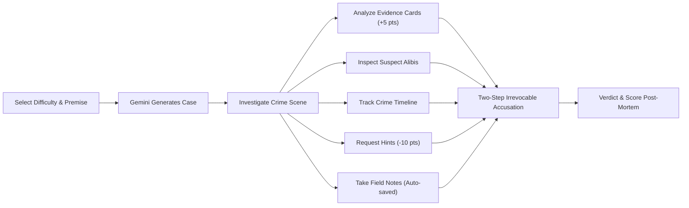

# 🕵️ AI Mystery Room

[](https://ai-mystery-room-sqai.vercel.app/)
[](https://ai-mystery-room-2-qc7n.onrender.com/)
[](https://nodejs.org/)
[](https://www.typescriptlang.org/)
[](https://ai.google.dev/)
[](https://www.mongodb.com/atlas)

> **"Every clue tells a story. Can you find the truth?"**  
> An AI-powered interactive detective investigation game. Generate unique, logically consistent murder and theft mysteries powered by Google Gemini, examine forensic evidence, interrogate suspect alibis, track crime timelines, and deliver your final, irreversible verdict.

---

## 🌐 Live Production Deployments

| Component | Platform | Live URL | Status |
| :--- | :--- | :--- | :--- |
| **Frontend App** | **Vercel** | [https://ai-mystery-room-sqai.vercel.app/](https://ai-mystery-room-sqai.vercel.app/) | ✅ Live |
| **Backend API** | **Render** | [https://ai-mystery-room-2-qc7n.onrender.com/](https://ai-mystery-room-2-qc7n.onrender.com/) | ✅ Live |
| **Health Check** | **Render** | [https://ai-mystery-room-2-qc7n.onrender.com/api/health](https://ai-mystery-room-2-qc7n.onrender.com/api/health) | `{"status":"ready","database":"connected"}` |

---

## 📑 Table of Contents

- [Live Deployments](#-live-production-deployments)
- [Detective Experience & Visual Identity](#-detective-experience--visual-identity)
- [Core Gameplay Mechanics](#-core-gameplay-mechanics)
- [Authoritative Difficulty & Scoring Rules](#-authoritative-difficulty--scoring-rules)
- [Security & Solution Privacy](#-security--solution-privacy)
- [System Architecture & Tech Stack](#-system-architecture--tech-stack)
- [API Reference](#-api-reference)
- [Local Development Setup](#-local-development-setup)
- [Testing & Quality Assurance](#-testing--quality-assurance)
- [Deployment Guide](#-deployment-guide)
- [Repository Structure](#-repository-structure)
- [License & Acknowledgments](#-license--acknowledgments)

---

## 🎨 Detective Experience & Visual Identity

The interface delivers a **cinematic, tactile detective aesthetic**:
- **Palette:** Rich charcoal (`#0c0d10`), deep burgundy dossiers (`#181116`), warm ivory typography (`#f5f0e8`), and weathered brass/amber accents (`#d4a359`).
- **Typography:** Playfair serif headlines with clean Inter body copy and compact monospace evidence tags (`[LOG-001]`, `[FORENSIC-CCTV]`).
- **Thematic Evidence Displays:**
  - 📹 **CCTV Frames:** Low-light camera stills with honest timestamp overlays (no synthetic videos).
  - 💬 **Encrypted Chat Transcripts:** Timestamped messaging logs exposing suspect communications.
  - 🏢 **Badge Access Logs:** Raw terminal-style door and terminal swipes.
  - 🔬 **Forensic Lab Notes:** Chemical and ballistics analysis reports.
  - 📦 **Physical Evidence:** Tagged evidence locker items with chain-of-custody labels.
  - 🗣️ **Witness Statements:** Sworn depositions with interviewer notes.

---

## 🎮 Core Gameplay Mechanics



1. **Case Creation:** Enter your own premise or choose curated defaults. Select difficulty (**Easy**, **Medium**, **Hard**) and narrative depth (**Standard** vs. **Extended**).
2. **AI Case Generation:** Google Gemini (`@google/genai`) dynamically crafts a completely coherent case with motives, verified alibis, interconnected clues, and exactly one culprit.
3. **Forensic Discovery:** Clues start as sealed summaries. Analyzing a clue reveals the full forensic report and awards **+5 clue discovery points**.
4. **Suspect Dossiers:** Click suspect profiles to inspect their background, stated motive, verified alibis, and directly linked evidence files.
5. **Timeline Chronology:** Trace every event leading up to the crime to identify contradictions in suspect claims.
6. **Tactical Hints:** Need assistance? Request progressive hints. Each hint deducts **-10 points** with backend idempotency protection.
7. **Two-Step Accusation:** When ready, select the primary suspect, provide your investigative rationale, confirm the irreversible warning modal, and submit.
8. **Case Post-Mortem:** Receive your official detective verdict, comprehensive scoring breakdown, and the fully unredacted case solution revealing the culprit's motive and method.

---

## ⚖️ Authoritative Difficulty & Scoring Rules

### Difficulty Parameters

| Difficulty | Suspects | Evidence Clues | Max Hints | Base Points (Correct Accusation) |
| :--- | :---: | :---: | :---: | :---: |
| **Easy** | **3** | **5** | **2** | **100** |
| **Medium** | **4** | **7** | **3** | **150** |
| **Hard** | **5** | **9** | **3** | **200** |

### Mathematical Scoring Formula

$$\text{Final Score} = \max\left(0, \;\text{BasePoints} + (\text{DiscoveredClues} \times 5) - (\text{HintsUsed} \times 10)\right)$$

* **Base Points:** Awarded **only** if the accused suspect is the true culprit. Incorrect accusations receive **0 base points**.
* **Clue Discovery (+5 pts each):** Earned per unique clue analyzed. Duplicate inspections are idempotent and never award bonus points.
* **Hint Deduction (-10 pts each):** Deducted per hint unlocked. Retrying the same hint request with an `idempotencyKey` incurs zero extra deduction.
* **Non-Negative Score Floor:** Final scores are strictly bounded at **0** (no negative final scores).
* **Case Length Integrity:** Standard vs. Extended lengths control narrative flavor only; they never alter scoring weights or required counts.

---

## 🔒 Security & Solution Privacy

- **Server-Authoritative Truth:** The solution (culprit ID, method, motive, and decisive evidence) is stored in private server-side schema fields.
- **DTO Redaction:** All public DTO endpoints (`toPublicCaseDto`) strip solution data until a final, valid accusation has been submitted.
- **Guest Identity & Cross-Origin Cookies:** Uses `amr_guest` cookies configured with `SameSite=None; Secure: true` and an `x-investigator-id` header fallback to guarantee seamless cross-origin session persistence across Vercel and Render.
- **Idempotent Mutations:** Hint requests and accusations support `idempotencyKey` headers to guard against double-submissions.
- **Input Sanitization:** All payload endpoints are validated at runtime via strict **Zod** schemas.

---

## 🏗️ System Architecture & Tech Stack

```
AI Mystery Room
├── client/ (Vite + React 18 + Tailwind CSS)
│   ├── Deployed to Vercel (SPA routing with vercel.json)
│   ├── Communicates with Backend via REST API (Credentials + x-investigator-id)
│   └── Local storage mirror for uninterrupted cross-origin authentication
│
└── server/ (Node.js + Express + TypeScript + Mongoose)
    ├── Deployed to Render Web Service
    ├── Official Google GenAI SDK (@google/genai) with structured JSON schemas
    ├── High-reliability procedural fallback generator if AI rate limits occur
    └── MongoDB Atlas for persistent case dossiers and player notes
```

### Technology Matrix

| Layer | Technologies |
| :--- | :--- |
| **Frontend** | React 18, TypeScript, Vite, Tailwind CSS, Lucide Icons |
| **Backend** | Node.js, Express, TypeScript, Mongoose, Zod, Cookie-Parser, CORS |
| **Artificial Intelligence** | `@google/genai` (Google Gemini 2.5/1.5 Flash & Flash-Lite models) |
| **Database** | MongoDB Atlas (Mongoose ODM with strict validation indexes) |
| **Hosting & CI/CD** | Vercel (Frontend), Render (Backend API), GitHub |

---

## 🔌 API Reference

Base API Route: `/api`

| Method | Endpoint | Description | Auth |
| :--- | :--- | :--- | :--- |
| `GET` | `/` | Root API service status and documentation link | Public |
| `GET` | `/api/health` | Server and MongoDB Atlas connectivity check | Public |
| `GET` | `/api/auth/session` | Get current investigator session and badge ID | Guest / Header |
| `POST` | `/api/cases` | Generate and save a new mystery case | Guest / Header |
| `GET` | `/api/cases` | List all cases for current investigator (My Cases) | Guest / Header |
| `GET` | `/api/cases/:id` | Fetch case details (solution strictly redacted) | Guest / Header |
| `POST` | `/api/cases/:id/clues/:clueId/discover` | Analyze clue, unlock full forensic data (+5 pts) | Guest / Header |
| `POST` | `/api/cases/:id/hints` | Unlock next sequential hint (-10 pts penalty) | Guest / Header |
| `PATCH` | `/api/cases/:id/notes` | Save investigator notes (debounced / manual) | Guest / Header |
| `POST` | `/api/cases/:id/accuse` | Submit final accusation, compute score, lock case | Guest / Header |
| `GET` | `/api/cases/:id/result` | Fetch verdict, full solution, and score breakdown | Guest / Header |

### Example Case Creation Payload (`POST /api/cases`)
```json
{
  "premise": "A rare emerald disappears during a high-society museum gala.",
  "difficulty": "Medium",
  "caseLength": "Standard"
}
```

### Example API Response (`GET /api/cases/:id`)
```json
{
  "success": true,
  "data": {
    "case": {
      "id": "6724a8...",
      "caseNumber": "CASE-7482",
      "title": "The Emerald Blackout",
      "difficulty": "Medium",
      "status": "active",
      "score": 0,
      "suspects": [ ... ],
      "clues": [ ... ],
      "hints": [ ... ],
      "timeline": [ ... ],
      "investigatorNotes": ""
    }
  },
  "requestId": "f8a92e10-..."
}
```

---

## 💻 Local Development Setup

### 1. Prerequisites
- **Node.js:** v18.x, v20.x, or v22.x
- **npm:** v9.x or higher
- **MongoDB:** Local MongoDB instance or free MongoDB Atlas cluster
- **Google Gemini API Key:** [Google AI Studio](https://aistudio.google.com/)

### 2. Clone the Repository
```bash
git clone https://github.com/vishal-s-sollapure/AI-Mystery-Room.git
cd "AI Mystery Room"
```

### 3. Configure Environment Variables
Create a `.env` file in the project root:
```env
# Application
NODE_ENV=development
PORT=5000
CLIENT_ORIGIN=http://localhost:5173

# Database
MONGODB_URI=mongodb://127.0.0.1:27017/ai-mystery-room

# Google Gemini API
GEMINI_API_KEY=your_actual_gemini_api_key_here
GEMINI_MODEL=gemini-2.5-flash
GEMINI_TIMEOUT_MS=25000

# Security
SESSION_SECRET=a_very_long_secure_random_session_secret_32_chars
```

Create a `client/.env` file:
```env
VITE_API_BASE_URL=http://localhost:5000
```

### 4. Install Dependencies
```bash
npm install
```

### 5. Launch Full-Stack Development
```bash
npm run dev
```
- Frontend starts at: `http://localhost:5173`
- Backend API starts at: `http://localhost:5000`

---

## 🧪 Testing & Quality Assurance

The codebase includes comprehensive test suites verifying mathematical scoring integrity, DTO privacy sanitization, and Gemini schema conformity:

```bash
# Run all automated test suites across workspaces
npm test

# Run strict TypeScript typechecking
npm run typecheck

# Test production builds for client and server
npm run build
```

### Test Suite Highlights
- **`src/test/scoring.test.ts`:** Verifies base points, clue bonuses, hint penalties, and strict zero-score flooring.
- **`src/test/dto.test.ts`:** Verifies that culprit identities and motives are never exposed in public case responses.
- **`src/test/mystery.service.test.ts`:** Verifies case generation counts, clue discovery idempotency, hint limits, and accusation workflows.
- **`src/test/gemini.validation.test.ts`:** Validates runtime schema parsers against AI responses.

---

## 🚀 Deployment Guide

### Deploying Frontend to Vercel
1. Link the repository to your Vercel account.
2. Set the **Root Directory** to `client` (or use the root `vercel.json` provided).
3. Set the Environment Variable:
   - `VITE_API_BASE_URL`: `https://ai-mystery-room-2-qc7n.onrender.com`
4. Deploy!

### Deploying Backend to Render
1. Create a **New Web Service** pointing to your repository.
2. Configure settings:
   - **Environment:** `Node`
   - **Build Command:** `npm install; npm run build`
   - **Start Command:** `npm start`
3. Add Environment Variables:
   - `NODE_ENV`: `production`
   - `MONGODB_URI`: `mongodb+srv://<user>:<password>@cluster.mongodb.net/ai-mystery-room`
   - `GEMINI_API_KEY`: `<your_gemini_api_key>`
   - `CLIENT_ORIGIN`: `https://ai-mystery-room-sqai.vercel.app`
   - `SESSION_SECRET`: `<32_character_random_string>`
4. Deploy!

---

## 📁 Repository Structure

```
AI Mystery Room/
├── client/                     # Frontend SPA (React 18 + Vite + Tailwind)
│   ├── src/
│   │   ├── components/         # Detective modals (Accusation, Manual, Dossier)
│   │   ├── pages/              # HomePage, InvestigationPage, ResultPage
│   │   ├── services/           # Axios/Fetch API client with auth handling
│   │   ├── types/              # Client TypeScript models
│   │   ├── App.tsx             # Root router and investigation coordinator
│   │   └── main.tsx            # DOM root
│   ├── vercel.json             # Vercel SPA routing rules
│   └── package.json
│
├── server/                     # Backend REST API (Node.js + Express)
│   ├── src/
│   │   ├── config/             # Environment validation with Zod
│   │   ├── middleware/         # Auth cookie middleware & error interceptors
│   │   ├── models/             # Mongoose MysteryCase schema & indexes
│   │   ├── routes/             # REST routes (/api/cases, /api/health)
│   │   ├── schemas/            # Zod validation and DTO privacy redactors
│   │   ├── services/           # Gemini AI service, Mystery service, Scoring
│   │   ├── test/               # Node test runner automated test suites
│   │   ├── app.ts              # Express application factory & CORS setup
│   │   └── server.ts           # Server bootstrap and graceful shutdown
│   └── package.json
│
├── docs/                       # Project Documentation
│   ├── SPEC.md                 # Product and game engineering specifications
│   ├── ARCHITECTURE.md         # System design and data flow architecture
│   ├── API.md                  # Detailed REST API specification
│   └── GAP_REPORT.md           # Implementation audit and audit trail
│
├── vercel.json                 # Monorepo Vercel deployment orchestration
├── package.json                # Root npm workspaces configuration
└── README.md                   # Project overview and documentation
```

---

## 📜 License & Acknowledgments

- **License:** MIT License. Free for educational, portfolio, and non-commercial development.
- **Built with:** [Google Gemini API](https://ai.google.dev/), [React](https://react.dev/), [Node.js](https://nodejs.org/), [MongoDB](https://www.mongodb.com/).
- **Created by:** [Vishal S. Sollapure](https://github.com/vishal-s-sollapure)
